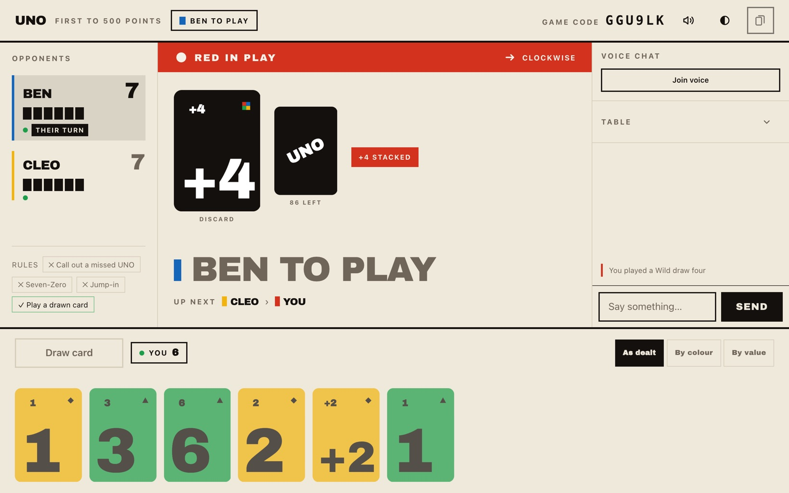
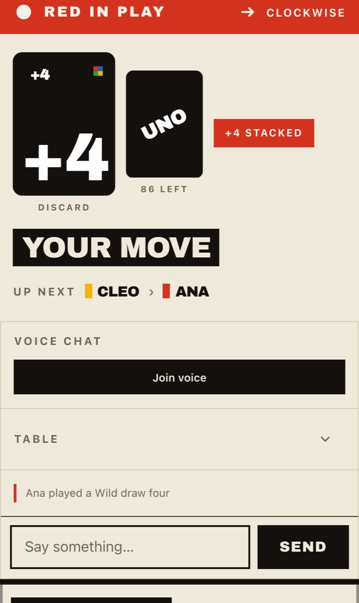
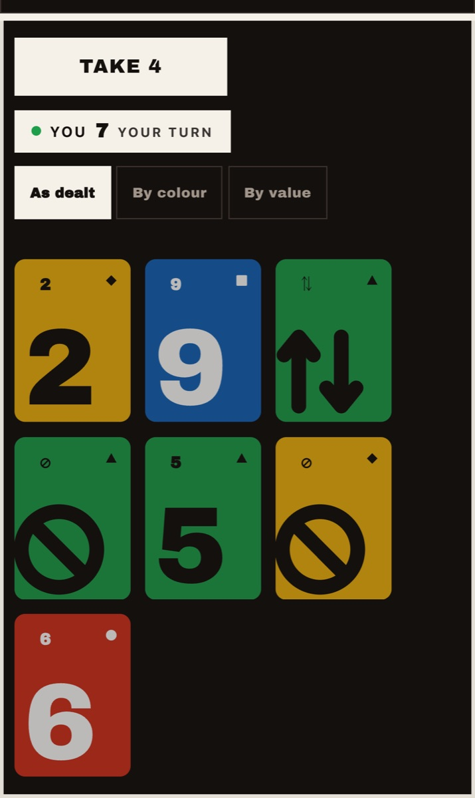
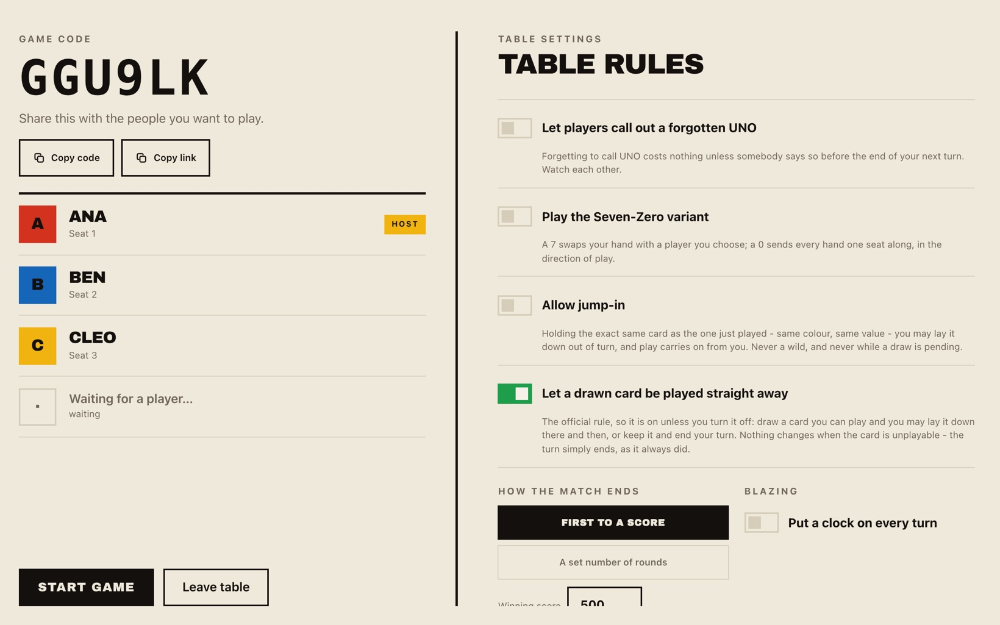

<p align="center">
  
</p>

<h1 align="center">UNO Multiplayer</h1>

<p align="center">
  Online UNO for two to four players, in the browser, with friends.<br />
  Official rules plus draw stacking, house rules as table options, voice chat built in.
</p>

<p align="center">
  <strong><a href="https://uno.jdelgado.fr">Play it at uno.jdelgado.fr</a></strong>
</p>

<p align="center">
  
</p>

<p align="center">
  
  &nbsp;
  
</p>

## Features

- **Official UNO plus draw stacking**, scored the Mattel way: the round winner takes the value of every card left in the other hands.
- **House rules per table**: UNO call-out, Seven-Zero, jump-in, playing the card you just drew.
- **Matches**: first to a score or a set number of rounds, with an optional turn clock.
- **Invite by link** or six-character code; a player who reloads or drops keeps their seat and hand.
- **At the table**: colour in play, direction, who is up next, pending draw stack, a move log and chat.
- **Hand sorting**: as dealt, by colour or by value, remembered per device.
- **Five card faces** (poster, classic, flat, letterpress, neon) and light, dark or system mode, chosen per player.
- **Phone first**: the whole table, hand and chat stay usable on a portrait phone, and the game installs to the home screen and opens full screen.
- **Voice chat** over a WebRTC mesh that never touches the server.
- **French and English** interface.

The server owns the state and the rules and sends each player only what that player may see: opponents' cards never cross the wire. See [Server authority](openwiki/architecture/server-authority.md).

<p align="center">
  
</p>

## Rules

| Table rule            | Default | Effect                                                                                                         |
| --------------------- | ------- | -------------------------------------------------------------------------------------------------------------- |
| Call out a missed UNO | off     | Forgetting UNO costs two cards only if an opponent calls it out. Off: the penalty applies after three seconds. |
| Seven-Zero            | off     | A 7 swaps your hand with a player you choose; a 0 passes every hand one seat along, in the direction of play.  |
| Jump-in               | off     | Holding the exact card just played, you may lay it out of turn; play carries on from you.                      |
| Play a drawn card     | on      | A playable card you draw may be laid at once. Off: drawing ends your turn.                                     |

| Match setting | Default      | Range                                         |
| ------------- | ------------ | --------------------------------------------- |
| Match ends    | first to 500 | a score from 50 to 2000, or 1 to 20 rounds    |
| Blazing       | off          | a turn clock from 3 to 120 seconds (15 if on) |

Always on: draw stacking is strictly same type (+2 on +2, +4 on +4), a reverse with two players acts as a skip, and the starting card is the first number card. Every edge case is pinned down in [Rules and scoring](openwiki/domain/rules-and-scoring.md).

## Run it locally

**Node 26**, pinned in `.nvmrc`.

```bash
npm install
npm run build                 # once, so the server has dist/ to run
npm start -w @uno/server      # API and WebSockets on http://localhost:5050
```

Second terminal, for the client with hot reload:

```bash
npm run dev -w @uno/web       # http://localhost:5173, proxies /socket.io and /healthz to 5050
```

Serving the built client from the server, reachable from a phone on the same network:

```bash
LAN_IP=192.168.1.12
PORT=5050 \
STATIC_ROOT=$PWD/apps/web/dist \
CORS_ORIGIN=http://localhost:5050,http://$LAN_IP:5050 \
npm start -w @uno/server      # then open http://192.168.1.12:5050 on the phone
```

| Variable      | Default | Purpose                                          |
| ------------- | ------- | ------------------------------------------------ |
| `PORT`        | `5050`  | HTTP and WebSocket port                          |
| `STATIC_ROOT` | unset   | Serve the built client from this directory       |
| `CORS_ORIGIN` | unset   | Comma-separated origins allowed to open a socket |
| `BEHIND_TLS`  | `false` | Set to `true` behind an HTTPS reverse proxy      |
| `TURN_URL`    | unset   | TURN relay for voice chat behind a symmetric NAT |
| `TURN_SECRET` | unset   | Shared secret with coturn, for relay credentials |

Rate limits, room cap and grace period are read in `apps/server/src/config.ts`. Restart the server after every `npm run build`: a stale `dist/` means a new client talking to an old server.

| Script                 | What it does                                    |
| ---------------------- | ----------------------------------------------- |
| `npm run verify`       | lint, typecheck and unit tests                  |
| `npm run format:check` | Prettier check, run in CI                       |
| `npm run watch`        | `tsc --build --watch` while editing server code |
| `npm run e2e`          | Playwright against a real build                 |

## Deploy it

CI publishes an image on every green push to `main`.

```bash
docker compose up --build      # then open http://localhost:5050
```

Behind Traefik, `compose.traefik.yaml` is ready to use: replace the hostname, the cert resolver and the network name, then `docker compose -f compose.traefik.yaml up -d`. No WebSocket configuration is needed. It also carries an optional `coturn` service: copy `coturn/turnserver.conf.example`, fill in the three `REPLACE` values and set `TURN_SECRET` to the same secret.

**One replica, always.** Game state lives in memory, so two processes would each hold half the rooms. A restart drops games in progress.

**Voice chat needs HTTPS.** `getUserMedia` only exists in a secure context; `localhost` is the only exemption.

Rollback by SHA tag and probing a live instance are in [Deploying](openwiki/operations/deploying.md).

## Project layout

| Path                | Contents                                                   |
| ------------------- | ---------------------------------------------------------- |
| `packages/engine`   | Pure rules, no I/O                                         |
| `packages/protocol` | Views, events and Zod schemas shared by server and client  |
| `apps/server`       | Fastify and Socket.IO: rooms, timers, the only state owner |
| `apps/web`          | Vite and React client                                      |
| `e2e`               | Playwright suites                                          |

## Documentation

The manual lives in [`openwiki/`](openwiki/quickstart.md): every page explains why something is the way it is.

| Page                                                          | What it covers                                                                |
| ------------------------------------------------------------- | ----------------------------------------------------------------------------- |
| [Quickstart](openwiki/quickstart.md)                          | Repository shape, running it, the toolchain, where the reasoning lives        |
| [Server authority](openwiki/architecture/server-authority.md) | The one decision everything follows from; engine invariants, the wire         |
| [The client](openwiki/architecture/client.md)                 | React layers, card faces, palette, sound, internationalisation, accessibility |
| [Voice chat](openwiki/architecture/voice-chat.md)             | The WebRTC mesh, signalling and the TURN relay                                |
| [Rules and scoring](openwiki/domain/rules-and-scoring.md)     | Every rule pinned down, the four table rules, match scoring, Blazing          |
| [Room lifecycle](openwiki/domain/room-lifecycle.md)           | Rooms, seats, reconnection, timers, configuring the table                     |
| [Deploying](openwiki/operations/deploying.md)                 | Docker, Traefik, configuration, the published image                           |
| [Testing](openwiki/operations/testing.md)                     | Which tool proves which claim, and the traps this suite has hit               |

The [design spec](docs/superpowers/specs/2026-08-04-uno-multiplayer-design.md) records the decisions and the rejected alternatives, with one spec per significant feature beside it. What is built and what is still open is in [`docs/ROADMAP.md`](docs/ROADMAP.md).

## Licence

ISC. See [LICENSE](LICENSE).
